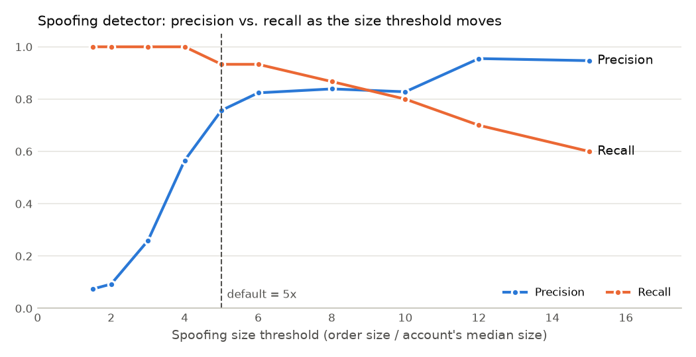

# Design notes: how this works and why

This document explains every design decision in plain English: what each kind of
manipulation is, why it is illegal, exactly how each detector decides, why each
threshold has the value it has, where the detectors go wrong, and what a real
exchange surveillance system does differently. No finance background is assumed.

**Contents**

1. [Vocabulary in two minutes](#1-vocabulary-in-two-minutes)
2. [The big picture](#2-the-big-picture)
3. [The synthetic market](#3-the-synthetic-market)
4. [Wash trades](#4-wash-trades)
5. [Spoofing](#5-spoofing)
6. [Layering](#6-layering)
7. [How the detectors are scored](#7-how-the-detectors-are-scored)
8. [What a real surveillance system does differently](#8-what-a-real-surveillance-system-does-differently)
9. [Interview cheat sheet](#9-interview-cheat-sheet)

---

## 1. Vocabulary in two minutes

| Term | Meaning |
|---|---|
| **Futures contract** | An agreement to buy or sell something (here, Brent crude oil) at a set price on a future date. Traded on exchanges such as ICE. |
| **Lot** | One contract. For ICE Brent, 1 lot = 1,000 barrels. |
| **Order book** | The exchange's live list of everyone's resting orders: **bids** (offers to buy) and **asks/offers** (offers to sell). |
| **Best bid / best ask** | The highest bid and the lowest ask. Together they are the **touch** (also called the top of book). The gap between them is the **spread**. |
| **Tick** | The smallest allowed price step. ICE Brent: $0.01 per barrel. |
| **New / cancel / fill** | The three events in an order's life: it is entered, it is withdrawn, or it trades (all or part of it). |
| **Aggressor vs. resting order** | A trade happens when an incoming (aggressive) order crosses the spread and matches an order already resting in the book. |
| **Account / beneficial owner** | The account is the trading identifier the exchange sees. The beneficial owner is the person or firm that actually gains or loses money from it. One owner can control several accounts. |
| **Market maker** | A firm that continuously quotes both a bid and an ask and earns the spread. Market makers cancel and replace orders constantly, and that is legitimate. |
| **Alert** | A flag raised by surveillance for an analyst to review. An alert is not an accusation. |
| **Precision / recall** | Precision: of the alerts raised, how many were real. Recall: of the real cases, how many were caught. |

---

## 2. The big picture

```
generate_data.py            detectors/                     evaluate.py
┌──────────────────┐   events.csv   ┌───────────────────┐  alerts   ┌──────────────────┐
│ matching engine  │ ─────────────▶ │ wash_trades.py    │ ────────▶ │ compare to       │
│ + 50 normal accts│                │ spoofing.py       │           │ labels.csv       │
│ + 9 manipulators │ ─ labels.csv ─▶│ layering.py       │           │ precision/recall │
└──────────────────┘ (ground truth) └───────────────────┘           │ threshold sweep  │
                                             │                      └──────────────────┘
                                             ▼
                                    app.py (Streamlit): analyst view
```

* Each detector is a **pure function**: an events DataFrame in, an alerts DataFrame
  out. Nothing is hidden in global state, so each detector is easy to test and to
  reason about.
* All thresholds live in **`config.py`**, so tuning never means hunting through
  the code.
* Every alert has the same columns: `pattern, account_id, related_accounts,
  start_ms, end_ms, score (0-100), evidence, order_ids`. The `evidence` field is
  one plain-English sentence an analyst can read without opening the data. Real
  surveillance alerts are judged on how quickly a human can understand them.

### Rebuilding the order book (`detectors/common.py`)

Questions like "was this order near the touch?" need to know where the market was
at that moment. The data holds only events, so `add_bbo()` **replays every
new/fill/cancel in time order** to rebuild the book. It records the best bid and
best ask just before each event. Exchange surveillance does the same thing with
the exchange's own message logs.

`order_summary()` then collapses events into one row per order: size, entry time,
cancel time, filled quantity, and distance from the touch at entry. Both the
spoofing and layering detectors work from this table.

---

## 3. The synthetic market

### Why synthetic?

Real order-level futures data with account IDs is confidential. Only the exchange
and regulators (the CFTC in the US, the FCA in the UK) see it. Synthetic data has
one large advantage: **we know the right answer**. Because we inject the
manipulation ourselves, we can measure precision and recall exactly, which is
impossible with real data where nobody knows the full truth.

### How the simulation works

`generate_data.py` runs a small exchange.

* **A real matching engine.** Orders match by price-time priority (best price
  first, then first come, first served). Fills come from actual order matching
  rather than being drawn at random, so prices, fills and cancels stay consistent
  with each other.
* **A hidden "fair value".** It drifts as a random walk. Aggressive traders buy
  more when the market is below fair value and sell more when it is above. This
  is what makes the price move.
* **Traders react to the visible book.** If bids heavily outweigh asks near the
  touch (book *imbalance*), takers lean toward buying. This is the behavior a
  spoofer exploits. Without it, fake orders in the simulation would have no
  effect on anyone.
* **Self-match prevention.** About 85% of accounts use the exchange's
  self-match/self-trade prevention tool. The rest occasionally trade with
  themselves by accident, which gives the wash-trade detector innocent cases to
  ignore.

**Who trades** (one 8-hour session, 08:00-16:00, seed 42):

| Group | Count | Behavior |
|---|---|---|
| Market makers | 5 | Quote 2-3 price levels on **both** sides, cancel and requote every 10-25 s **and right after every fill**. The main innocent look-alike for layering. |
| Ordinary traders | 42 | Mix of resting and aggressive orders, sizes around their own median (1-8 lots). Some occasionally place a **large order and pull it within seconds** ("nervous" behavior), which is the main innocent look-alike for spoofing. Two pairs are **linked accounts** under the same owner but trade independently. |
| Hedgers | 3 | Large (25-50 lots), one-directional, long-resting orders. They show why "large" must be measured against the account's own habits. |
| Manipulators | 9 | They trade normally all day like everyone else, which is realistic and gives each one a measurable normal order size. They also run the injected schemes below. |

The result is 165,775 events: 79,006 new orders, 69,235 cancels and 8,767
trades. Brent trades between $74.24 and $75.85. About 88% of orders are canceled,
which is in line with real electronic futures markets, where most orders never
trade.

### Injected manipulation (the ground truth)

| Pattern | Incidents | How it is injected |
|---|---|---|
| Wash trades | 18 | One account self-matching 2-4 times; a **known linked** pair doing a 2-4-trade round trip; an **unlinked** pair doing two rapid round trips (a hidden link). Orders are placed inside the spread so they meet each other. |
| Spoofing | 30 | Small genuine order on one side, then 1-2 large orders (**4-20x** the account's normal size) at or 1-2 ticks behind the opposite touch. These are pulled 0.15-1.5 s after the genuine order fills. If it hasn't filled within ~3-4 s, the spoofer crosses the spread to buy or sell at the improved price, then pulls the spoof. |
| Layering | 24 | Small genuine order on one side, then **3-6 orders at distinct price levels** stacked on the other side (each 1.5-4x normal size). All are pulled together after the genuine fill. |

Spoof sizes deliberately vary from 4x to 20x. Some injected spoofs are therefore
*below* the detector's default threshold, which is realistic: not every spoofer
uses enormous orders. `labels.csv` records each incident's accounts, time window
and order IDs.

### Limitations of synthetic data (say this before anyone asks)

* **I wrote both the market and the detectors.** Even with care, the patterns are
  cleaner than reality. Real numbers would be lower. That is why there is a
  multi-seed robustness check (section 7) and why the innocent look-alikes were
  built in on purpose.
* Real manipulators adapt: they randomize sizes and timing and spread activity
  across accounts and products.
* There are no order **modifications** (real exchanges let you amend price or
  size, which spoofers use), no iceberg orders, and only one product.

---

## 4. Wash trades

### What it is

A **wash trade** is a trade where nothing really changes hands. The same person is
effectively both buyer and seller. It might be one account trading with itself, or
two accounts owned by the same person trading with each other.

### Why people do it, and why it's illegal

Wash trades create **fake volume and fake prices**. Uses include making a contract
look more liquid than it is, printing a price to mark a position or influence a
settlement, generating volume-based rebates, or shifting profits between accounts
for tax reasons.

* **Commodity Exchange Act (CEA) Section 4c(a)** makes it unlawful to enter into a
  "wash sale", a fictitious sale, or an accommodation trade.
* **Exchange rules** prohibit it too. CME Rule 534 is the most-cited example, and
  ICE's rulebooks have equivalent trade-practice rules. A key nuance: trades
  between commonly owned accounts are prohibited when entered with intent to
  avoid a genuine change in position. Two **independent** desks of the same firm
  that happen to trade with each other are not automatically violating anything.
  That is why the detector looks for a *pattern* rather than a single trade.
* Exchanges offer **self-match prevention** tools, and firms are expected to use
  them.

### How the detector decides (`detectors/wash_trades.py`)

1. **Turn fills into trades.** Every trade has exactly one buy-side fill row,
   whose counterparty is the seller. That gives one row per trade: buyer, seller,
   price, size, time.
2. **Classify each trade** into one of three rules:
   * **Self-match**: buyer account == seller account.
   * **Linked accounts**: different accounts listed in `account_links.csv` (the
     exchange's ownership reference data) as sharing a beneficial owner.
   * **Round trip (hidden link)**: two accounts *not* known to be linked, where A
     sells to B and then within 30 s B sells **the same size** back to A at about
     the same price (within 2 ticks). Each account ends where it started, so no
     real risk changed hands.
3. **Group into episodes.** Trades by the same account or pair within 60 s of each
   other form one episode.
4. **Alert** if an episode has at least 2 self-match or linked trades, or at least
   2 round trips.
5. **Score** (0-100): self-match starts at 70 and linked accounts at 60 (both are
   strong, objective facts); each extra trade adds 10. Round trips start at 40,
   because without ownership data they are only circumstantial evidence.

### Thresholds and why

| Setting | Default | Why this value | Tradeoff |
|---|---|---|---|
| `min_trades` | 2 | One self-match is usually two of a firm's own algorithms crossing by accident. Repetition shows a pattern. | 1 = flag every accident (alert flood); 3+ = miss short wash bursts. |
| `cluster_gap_s` | 60 s | Wash episodes are quick. A minute keeps one episode together without merging unrelated activity. | Larger merges unrelated trades; smaller splits one episode into several sub-threshold pieces. |
| `round_trip_window_s` | 30 s | A pre-arranged round trip happens fast. Genuine two-way trading between the same pair at the same size within seconds is rare. | Larger catches slow round trips but starts matching unrelated two-way flow. |
| `round_trip_max_price_diff_ticks` | 2 | A round trip at a very different price is a real profit or loss, not a wash. | Larger risks flagging genuine trading. |
| `min_round_trips` | 2 | This rule has no ownership evidence, so it demands repetition. | 1 = many coincidences flagged. |

### Known false positives

* **Accidental self-matches** by an account without self-match prevention. Two can
  land in one 60-second window: the single wash false positive in the results is
  exactly this, two self-matches 85 ms apart from an ordinary trader. A real
  analyst would close it quickly and probably tell the firm to turn on
  self-match prevention.
* **Independent desks of the same firm** that trade with each other more than
  twice in a minute. That is legal if the desks really are independent. The
  analyst checks with the firm.
* **Hidden-link rule:** two very active market participants can occasionally
  produce matched round trips by coincidence.

### What it misses

* Wash trades spread across accounts the exchange doesn't know are linked, and
  done slowly (minutes apart, varying sizes). Catching those needs ownership
  investigation, not pattern matching.
* Wash trades executed across two products or venues.

---

## 5. Spoofing

### What it is

**Spoofing** means placing orders you **intend to cancel before they execute**, to
trick other traders about supply and demand. The classic sequence:

1. You want to **buy** a small amount cheaply.
2. You place a **large sell order** near the best ask. The book now looks heavy
   with sellers.
3. Other traders (and algorithms) read that as selling pressure, so they sell or
   lower their prices.
4. Your small buy order fills at the better price.
5. You **cancel the large sell order**, usually within seconds, before anyone can
   trade against it.

### Why it's illegal

* **CEA Section 4c(a)(5)(C)**, added by the Dodd-Frank Act in 2010, makes it
  unlawful to engage in trading that "is, is of the character of, or is commonly
  known to the trade as, 'spoofing' (bidding or offering with the intent to
  cancel the bid or offer before execution)."
* The CFTC's **2013 interpretive guidance on disruptive practices** describes
  spoofing as including orders meant to overload systems, delay others, create a
  false appearance of market depth, or create artificial price movements. It also
  makes two points worth knowing:
  * **Intent is the core element.** Canceling orders is normal; canceling orders
    you never meant to fill is the violation.
  * **A partial fill doesn't make it legal.** If you meant to cancel the whole
    order, getting clipped on part of it doesn't help you. That is why the
    detector tolerates up to 10% filled.
* Broader anti-manipulation authority comes from **CEA Section 6(c)** and **CFTC
  Rules 180.1-180.2**. Exchange rules (CME Rule 575, and ICE's equivalent
  disruptive-trading rules) also prohibit it.
* For Brent specifically, ICE Futures Europe is in London, so the **UK Market
  Abuse Regulation** applies as well, enforced by the FCA.
* **Landmark cases:**
  * **Michael Coscia (Panther Energy):** the first criminal spoofing conviction
    under Dodd-Frank (2015). His algorithm placed small orders on one side and
    large orders on the other, then canceled the large ones within milliseconds.
    The FCA also fined him for doing this in **ICE Futures Europe Brent and
    gasoil** contracts.
  * **Navinder Sarao:** E-mini S&P layering linked to the 2010 "Flash Crash".
  * **JPMorgan (2020):** about $920 million in penalties for spoofing in precious
    metals and Treasury futures.

> Verify exact rule citations against the current CFTC/ICE rulebooks before
> quoting them in an interview. The principles above are stable; rule numbers
> sometimes change.

### How the detector decides (`detectors/spoofing.py`)

An order is flagged only if it passes **all four** tests:

| # | Test | Default | Rationale |
|---|---|---|---|
| 1 | **Large for this account:** size >= 5x the account's own median order size, **and** >= 2x the market-wide median. | 5x / 2x | Spoof orders must be big enough to move perceptions. Comparing to the account's *own* habit means a hedger who always trades 40 lots isn't flagged for trading 40 lots. The market-wide floor stops a 1-lot trader being flagged for 5 lots. |
| 2 | **Near the touch at entry:** at most 3 ticks behind the best price on its side. | 3 ticks | An order deep in the book barely affects anyone. Spoofers put orders where they will be seen. |
| 3 | **Canceled quickly, essentially unfilled:** canceled within 5 s, at most 10% filled. | 5 s / 10% | Spoof orders are meant to be seen, not executed. |
| 4 | **Opposite-side fill by the same account** between 2 s before entry and 1 s after cancel. | -2 s / +1 s | This is the **motive**: the trade the fake order was helping. Without it, a big quick cancel is just a trader changing their mind. |

Flagged orders from the same account within 5 s are merged into one alert, so one
episode becomes one case.

**Score (0-100)** = 40% size (0.5 at the threshold, 1.0 at twice the threshold) +
30% speed (an instant cancel scores 1, a cancel at 5 s scores 0) + 30% asymmetry
(how much bigger the fake side was than the real fill). In plain terms: bigger,
faster and more lopsided means more suspicious, and analysts work the queue from
the top.

The `account's median` uses the account's whole day of orders and needs at least
20 orders. Below that, the account doesn't have a reliable "normal", so the
detector falls back to the market median.

### Why 5x? The sensitivity sweep

The size multiple is the main threshold. `evaluate.py` re-runs the detector at
1.5x-15x:



* **Below 4x**, precision collapses (7-26%). Ordinary size variation produces
  hundreds of alerts and analysts drown.
* **Above 8x**, recall falls quickly. Spoofers using moderately large orders get
  through.
* **5x** sits at the knee: 93% recall with 76% precision on the main seed.

On the main seed alone, 6x scores slightly better. I didn't move the default for
that reason, because tuning a threshold to one dataset is overfitting. Across 5
other simulated days, 5x has the best average F1 (0.875 vs. 0.872 for 6x) and
higher recall (0.88 vs. 0.81). In surveillance, **missing a real case usually
costs more than one extra alert to review**, which favors the lower threshold
when F1 is tied.

### Known false positives

All 9 false positives on the main seed come from the same innocent behavior. An
ordinary trader places an unusually large order, pulls it within about 1-4.5
seconds, and coincidentally has a small fill on the other side at the same
moment. Examples:

* A trader who **changed their mind** about a big order right as one of their
  small opposite orders filled.
* An account **hedging**: big order on one side, then a small offsetting trade.
* An algorithm **repricing** a large order as the market moves.

The detector cannot tell intent from the data alone. An analyst would look at
**how often** this happens for the account (a pattern across days is far more
telling than one episode), whether the market **actually moved** in their favor,
and, if it escalates, at **communications** and the firm's explanation.

### What it misses

* **Spoof orders below 5x** normal size. Two of 30 injected spoofs on the main
  seed were 4.7-4.8x. They are caught at 4x, at the cost of many more false
  positives.
* **Failed spoofs** with no opposite-side fill. Spoofing is illegal even if it
  doesn't work, but this detector anchors on the fill. A real system would add a
  rule based on repeated large-cancel behavior alone.
* **Cross-product spoofing:** spoof in one contract, profit in a related one.
* **Spoofing split across accounts** the exchange doesn't know are linked.
* Spoof orders deliberately **left longer** than 5 s.

---

## 6. Layering

### What it is

**Layering** is a form of spoofing. Instead of one big fake order, the trader
places **several orders at different price levels** on one side, creating a
false picture of deep buying or selling interest. After a genuine order on the
other side fills, they **cancel the whole stack** at once. Each individual order
can be modest in size, which is exactly why a single-order spoofing rule misses
it.

### Why it's illegal

The same laws as spoofing: CEA 4c(a)(5)(C) and the CFTC guidance, which
specifically mentions submitting or canceling multiple orders to create a false
appearance of market depth, plus exchange disruptive-practice rules and, for
Brent, UK MAR. **Sarao** (E-mini S&P) and **Coscia** (who layered in ICE Brent)
are the textbook examples.

### How the detector decides (`detectors/layering.py`)

For **every fill** an account receives, look at that account's orders on the
**other** side of the book:

| # | Test | Default | Rationale |
|---|---|---|---|
| 1 | **Stack:** the account had orders resting at >= 3 **distinct price levels** on the opposite side, all entered in the 10 s before the fill. | 3 levels / 10 s | Normal traders rarely have more than 2 levels on one side at once. The orders must have been placed *to set up* the fill. |
| 2 | **Pulled after the fill:** >= 80% of the stacked quantity canceled within 5 s after the fill. | 80% / 5 s | Fake depth is removed as soon as its job is done. 80% allows one layer to get partly hit. |
| 3 | **One-sided:** stacked quantity / (stacked quantity + what the account had resting on the fill side) >= 0.8. | 0.8 | **This is the market-maker filter** (see below). |

Fills from the same account within 10 s are merged into one alert.

**Score** = 30% number of levels + 25% fraction canceled + 20% cancel speed + 25%
one-sidedness.

### Why the one-sidedness test exists

Market makers do something that looks almost exactly like layering. They quote
several price levels, get filled, then **cancel everything** and requote. That is
legitimate: it is how they manage risk. The difference is that a market maker is
**two-sided**, with similar size resting on both bid and ask, while a layerer
leans heavily on one side. Without test 3, every market-maker requote after a
fill would raise an alert. A unit test confirms that removing this rule makes the
detector flag a market maker.

### Known false positives

* A **market maker whose whole ladder on one side was swept**, leaving it
  temporarily one-sided at the instant of the fill. The test measures the fill
  side *including* the order that just filled, which reduces but doesn't remove
  this case.
* A trader **scaling into a position** with a stack of bids who gets a small
  opposite fill and then cancels everything because the market moved.

### What it misses

* **A layerer with genuine resting orders on the fill side.** One missed incident
  on the main seed had an ordinary 9-lot bid resting next to the layering scheme,
  which pushed its one-sidedness to 0.75, just under 0.8. This is the direct cost
  of the market-maker filter.
* **Failed attempts with no fill.** The other missed incident is a layerer whose
  own layer ended up at the touch, so self-match prevention blocked the "genuine"
  trade. No fill means nothing to anchor on.
* Layering spread across accounts, stacks placed more than 10 s in advance, or
  stacks pulled slowly.

---

## 7. How the detectors are scored

### Matching alerts to incidents (`evaluate.py`)

An alert counts as a **true positive** if:

1. it has the **same pattern** as an injected incident,
2. it shares **at least one account** with it, and
3. its time window **overlaps** the incident window (padded by 5 s on each side).

* **Precision** = true-positive alerts / all alerts. It measures analyst time
  wasted.
* **Recall** = incidents with at least one matching alert / all incidents. It
  measures manipulation missed.
* **F1** = the harmonic mean of the two. It is high only when both are high.

The table also has a `hit_other_pattern` column: alerts that missed their own
pattern but landed on a different kind of real manipulation (for example, a
spoofing alert on a layering scheme). Strictly that is a false positive, but in
practice it is not innocent activity. It is 0 at the default settings.

### Results (seed 42)

| Pattern | Incidents | Alerts | Precision | Recall | F1 |
|---|---|---|---|---|---|
| Wash trades | 18 | 19 | 0.947 | 1.000 | 0.973 |
| Spoofing | 30 | 37 | 0.757 | 0.933 | 0.836 |
| Layering | 24 | 22 | 1.000 | 0.917 | 0.957 |

### Robustness: five more simulated days

`python evaluate.py --seeds 1 2 3 4 5` re-simulates five different days. Nothing
was tuned on these, so they act like a held-out test set:

| Pattern | Mean precision | Mean recall | Mean F1 | Worst-day F1 |
|---|---|---|---|---|
| Wash trades | 0.952 | 0.968 | 0.958 | 0.927 |
| Spoofing | 0.872 | 0.880 | 0.875 | 0.812 |
| Layering | 0.964 | 0.850 | 0.901 | 0.837 |

The scores stay stable from day to day, which suggests the thresholds aren't
fitted to one lucky dataset. They are still synthetic-data numbers and they
overstate real-world performance (see section 3).

### Why precision is not the only thing that matters

Exchange surveillance is a **triage** problem. Every alert costs analyst time, but
a missed spoofer costs market integrity and regulatory credibility. Teams usually
**tune for high recall at a manageable alert volume**, then use the score to rank
the queue so the most suspicious alerts are reviewed first.

---

## 8. What a real surveillance system does differently

| This project | A real exchange / regulator system |
|---|---|
| One product, one day | Every product, every day, plus **cross-product** checks (spoof in one contract, profit in a related one: Brent vs. WTI, futures vs. options, calendar spreads). |
| Account IDs plus a small links file | Full **ownership and control** data: registered beneficial owners, trader/operator IDs, give-ups, omnibus accounts, CFTC large-trader and ownership-and-control reports. |
| New / cancel / fill events | Every **message**: modifications, rejects, iceberg orders, implied orders, session and trader IDs, gateway timestamps to the microsecond. |
| Fixed thresholds | **Adaptive baselines** per product, per time of day, per participant type (a 50-lot order means something different in Brent at 14:30 London than at 07:00), often with statistical or ML scoring trained on past analyst decisions. |
| One episode at a time | **Patterns over weeks and months.** One spoof-like episode is noise; 300 is a case. Order-to-trade ratios, cancel ratios and repeat behavior are tracked per participant. |
| Detector only | **Case management**: alert queues, analyst notes, escalation, requests for information to member firms, communications review (chats, phone), and referral to enforcement. |
| No intent evidence | Intent is proved with **context**: did the market move in their favor, did they profit, what did their communications say, what was their strategy? |
| No market-impact measure | Measures of whether the fake orders actually **moved the price or the book**. |
| Built in pandas | Commercial platforms (e.g. Nasdaq SMARTS, Eventus Validus, Trading Technologies' surveillance tools) or in-house systems processing billions of messages a day. |

The biggest single difference is that **a real system has the full picture of who
is behind every order**.

---

## 9. Interview cheat sheet

**"Why synthetic data?"** Real order-level data with account IDs is confidential,
and with synthetic data I know the ground truth, so I can measure precision and
recall exactly. The limitation is that it's cleaner than reality, which I
mitigated with innocent look-alikes, varied manipulation sizes, and a held-out
multi-seed test.

**"Why measure size relative to the account's median and not an absolute
number?"** Because "large" depends on who you are. A hedger who always trades
40 lots isn't suspicious at 40 lots; a 2-lot trader at 40 lots is. I also
require a market-wide floor so tiny accounts don't trigger on trivially small
orders.

**"Why require an opposite-side fill?"** It's the motive. A big order canceled
quickly is common and usually innocent. The fill on the other side is what
connects the fake order to a benefit. The tradeoff is that failed spoofing
attempts are missed, and those are still illegal.

**"How do you avoid flagging market makers for layering?"** The one-sidedness
test. Market makers quote both sides and requote after every fill, which looks
like layering if you only look at one side. Requiring at least 80% of the
account's resting size to sit on the stacked side separates them. A unit test
proves that removing the rule causes a market-maker false positive.

**"What was your biggest source of false positives?"** In spoofing: ordinary
traders who pull a large order within a few seconds and happen to get a small
opposite fill at the same time. You can't tell intent from one episode. A real
analyst would look at frequency over time, price impact and communications.

**"How did you choose the 5x threshold?"** I reasoned it out first, then swept it.
Below 4x precision collapses, and above 8x recall drops. On my main dataset 6x
scored slightly better, but across 5 held-out days 5x had the best average F1
and higher recall, so I kept it. I didn't tune to a single dataset.

**"What would you add next?"** Order modifications, rules for repeated behavior
across days (order-to-trade and cancel ratios), price-impact measures, a
failed-spoof rule that doesn't need a fill, and cross-product linkage.

**"Is an alert an accusation?"** No. An alert means "a human should look at
this". Intent is the legal core of spoofing, and data alone rarely proves it.
