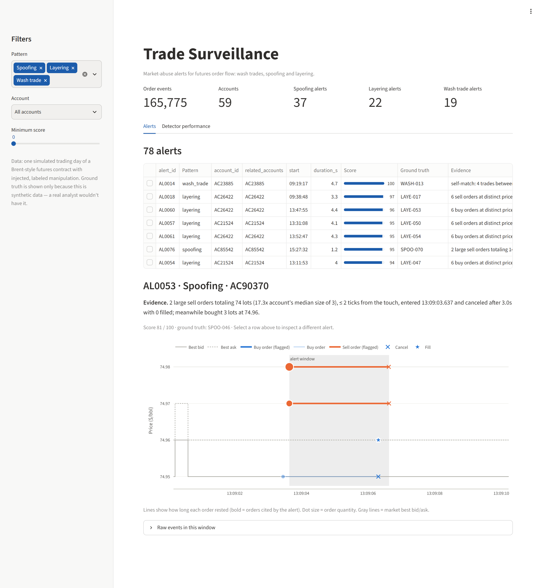
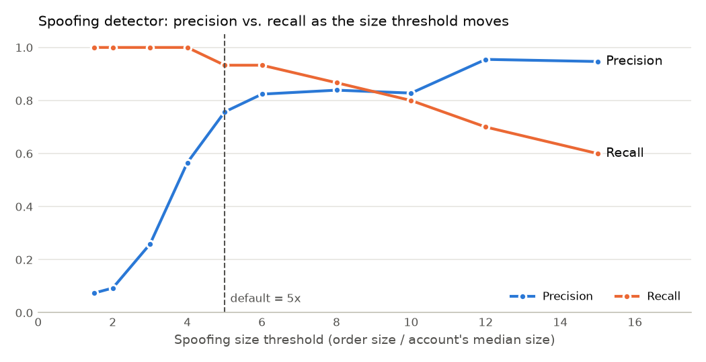
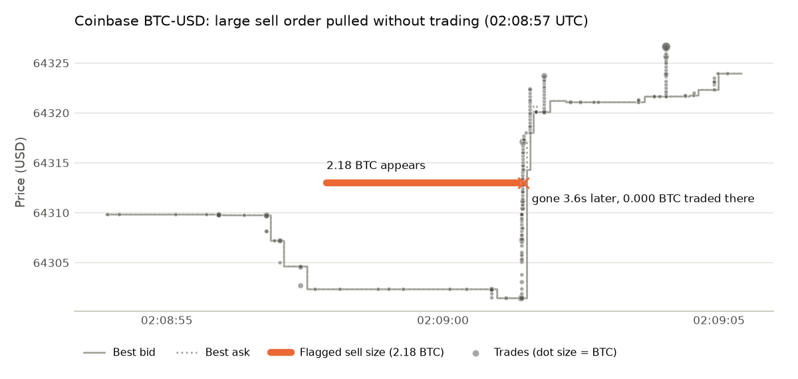

# trade-surveillance

Market-abuse detection for futures order flow: flags **wash trades**, **spoofing** and
**layering**, the way an exchange market-regulation team would, and measures itself
against labeled ground truth.



*Above: alert AL0053. The account rests a small buy at 74.95, places 74 lots of sell
orders 1-2 ticks above the ask (17x its normal size), buys at 74.96, then cancels
both sell orders 3.0 s after entering them with nothing filled.*

## Results

One simulated trading day of an ICE Brent-style contract (165,775 order events, 59
accounts, 72 injected incidents; seed 42):

| Pattern | Incidents | Alerts | Precision | Recall | F1 |
|---|---:|---:|---:|---:|---:|
| Wash trades | 18 | 19 | 0.947 | 1.000 | **0.973** |
| Spoofing | 30 | 37 | 0.757 | 0.933 | **0.836** |
| Layering | 24 | 22 | 1.000 | 0.917 | **0.957** |

On five more simulated days that were never used for tuning
(`python evaluate.py --seeds 1 2 3 4 5`), mean F1 is **0.958 / 0.875 / 0.901**
(wash / spoofing / layering).

**Threshold sensitivity.** The main spoofing threshold is how large an order is
relative to the account's own median size. Loosening it catches more spoofing but
buries analysts in innocent large orders:



Every false positive and every miss is explained in [DESIGN.md](DESIGN.md).

## Quick start

```bash
git clone https://github.com/adhirajpuri25/trade-surveillance.git
cd trade-surveillance
python -m venv .venv
source .venv/bin/activate          # Windows: .venv\Scripts\activate
pip install -r requirements.txt

python run.py                      # generate -> detect -> evaluate (~5 s)
streamlit run app.py               # analyst dashboard at http://localhost:8501
pytest                             # 21 tests
```

`run.py` writes everything to `data/`: events, ground-truth labels, alerts, metrics
and the threshold sweep. The fixed seed makes every run identical.

## How it works

| Stage | File | What it does |
|---|---|---|
| Data | `generate_data.py` | A small **price-time-priority matching engine** simulating a day of order flow: 5 market makers, 42 traders, 3 hedgers, and 9 manipulators who also trade normally. Writes `events.csv` (timestamp ms, order_id, account_id, side, price, quantity, event_type, counterparty_account_id), a separate `labels.csv` ground-truth file, and `account_links.csv` (known common ownership). |
| Wash trades | `detectors/wash_trades.py` | Self-matches, trades between **known linked** accounts, and repeated same-size **round trips** between unlinked accounts (a possible hidden link). |
| Spoofing | `detectors/spoofing.py` | An order **≥ 5x the account's median size**, within 3 ticks of the touch, **canceled within 5 s** essentially unfilled, while the same account **fills on the opposite side**. |
| Layering | `detectors/layering.py` | Orders at **≥ 3 distinct price levels** on one side, ≥ 80% canceled within 5 s of an **opposite-side fill**, and a one-sidedness filter so two-sided market makers aren't flagged. |
| Thresholds | `config.py` | **Every** threshold in one place, each with a comment on the more-alerts vs. more-false-positives tradeoff. |
| Evaluation | `evaluate.py` | Precision / recall / F1 per pattern, the spoofing threshold sweep, and a multi-seed robustness check. |
| Dashboard | `app.py` | Streamlit: alerts table with filters by pattern, account and score, plus a timeline of the flagged account's orders against the market's best bid/ask. |

Each detector is a pure function (events DataFrame in, alerts DataFrame out) with
the columns `account_id, related_accounts, start_ms, end_ms, pattern, score,
evidence, order_ids`. The `evidence` column is a sentence an analyst can act on,
for example:

> 6 sell orders at distinct price levels (73 lots) stacked from 09:38:48.127; buy 5 lots
> filled at 74.63, then 100% of the stack canceled within 0.3s; one-sidedness 92%.

## Tests

Each detector has hand-built scenarios: one clear violation, and innocent
look-alikes that must **not** be flagged. The look-alikes include a market maker
requoting both sides, a hedger trading at its normal large size, a big order left
resting, a single accidental self-match, and one-way trading between unlinked
accounts. There are also tests for the book replay, generator reproducibility and
the scoring logic.

## Project layout

```
config.py            all detection thresholds (with tradeoff comments)
generate_data.py     synthetic market + injected, labeled manipulation
detectors/           common.py (book replay), wash_trades.py, spoofing.py, layering.py
evaluate.py          precision/recall/F1, threshold sweep, multi-seed robustness
run.py               end-to-end pipeline
app.py               Streamlit dashboard
real_data/           Coinbase BTC-USD capture (raw/), order-level analysis, results (output/)
tests/               pytest scenarios
DESIGN.md            plain-English design notes: law, logic, thresholds, limitations
```

## Real market data: Coinbase BTC-USD

`real_data/` applies the spoofing idea to **real** order-book data. The public feed
has no account IDs, so this works at the order level. It flags unusually large
orders near the touch that are canceled within seconds without trading.

```bash
python -m real_data.capture --minutes 20   # record from Coinbase's public WebSocket (optional)
python -m real_data.analyze                # analyze the newest capture in real_data/raw/
```

The 20-minute capture analyzed here is committed (`real_data/raw/`, 3.8 MB gzipped), so
the analysis reproduces without reconnecting. Coinbase's order-by-order channels
(`full` / `level3`) now require an authenticated API key. The capture therefore uses
the public `level2_batch` channel (total size per price level, every 50 ms) plus
`matches` (every trade). A large add is inferred as a jump in the size at one price
level.

**What it found** (2026-11-18, 02:03-02:23 UTC; 418,864 book updates, 21,523 trades):

| | Count |
|---|---:|
| Size added within 2 bps of the touch | 60,899 (median 0.12 BTC) |
| Large adds (≥ 10x median **and** ≥ $100k) | 58 |
| ...pulled within 5 s with nothing traded at that price (**flagged**) | **47 (81%)** |
| ...filled / partly filled / still resting | 1 / 1 / 1 |
| *Ordinary* adds that pass the same "pulled within 5 s, unfilled" test | **80.5%** |

Examples of flagged orders (full list in `real_data/output/flagged_orders.csv`):

| Time (UTC) | Side | Price | Size | Behind best ask | Lifetime | Traded there |
|---|---|---:|---:|---:|---:|---:|
| 02:08:57.894 | sell | 64,312.99 | 2.18 BTC ($140k) | $10.65 | 3.6 s | 0 |
| 02:04:31.531 | sell | 64,232.99 | 2.13 BTC ($137k) | $11.31 | 1.6 s | 0 |
| 02:04:21.949 | sell | 64,251.99 | 2.12 BTC ($136k) | $11.30 | 4.1 s | 0 |
| 02:07:01.445 | sell | 64,232.65 | 2.03 BTC ($130k) | $10.67 | 1.1 s | 0 |



**The key limitation: there are no account IDs.** Every flagged order is on the sell
side, sized about 1.6-2.3 BTC, at the ask or $8-12 behind it, and lives about 1 s.
That looks like one or a few liquidity algorithms. But nothing in public data says
**who** placed them. We can't check whether the same trader was filling on the other
side, which is the test that separated spoofing from innocent activity in the
synthetic data. Fast cancellation alone separates nothing here: 81% of large adds
vanish, but so do 80.5% of ordinary ones. The chart's order was pulled exactly as
buyers swept up to its price. A spoofer would do that, and so would a market maker
protecting itself from an aggressive sweep. Without accounts, wash trades are also
undetectable: you can't see that buyer and seller are the same person. That is why
real surveillance is done by exchanges and regulators, who hold the full
account-level data. Details in [DESIGN.md §10](DESIGN.md#10-real-market-data-coinbase-btc-usd).

## Limitations

* **Synthetic data.** Real account-level futures data is confidential, so the
  market is simulated. Patterns are cleaner than in reality and the numbers above
  overstate real-world performance. [DESIGN.md](DESIGN.md) covers what was done
  about that (innocent look-alikes, varied manipulation sizes, held-out seeds).
* **One product, one day, no order modifications.** Real surveillance covers
  cross-product manipulation, patterns across weeks, and intent evidence such as
  communications. See [DESIGN.md §8](DESIGN.md#8-what-a-real-surveillance-system-does-differently).
* An alert is a prompt for human review, not a finding of manipulation.
